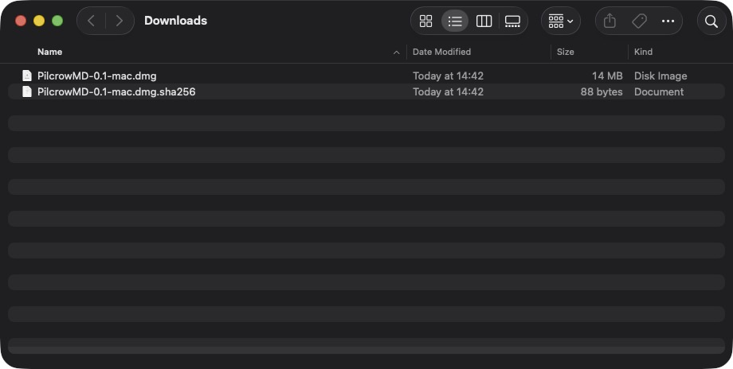
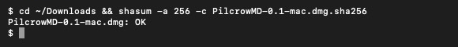
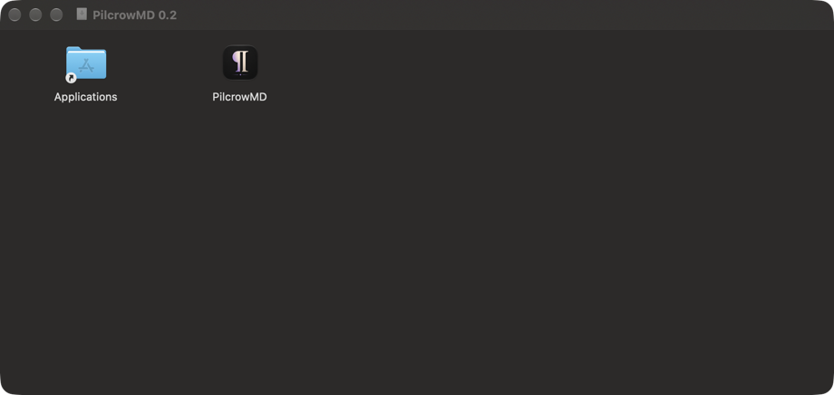
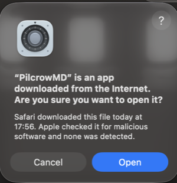

# Installing PilcrowMD (Mac)

PilcrowMD is a beta. It is signed and notarized by Apple: Apple checked it
for malicious software before it was published. macOS still asks you once
before the first open, as it does for any app downloaded from the internet.

You need a Mac with macOS 14 (Sonoma) or later.

The download files are named `PilcrowMD-<version>-mac.dmg` – for example
`PilcrowMD-0.3.5-mac.dmg`. In the steps below, read `<version>` as that number.

## 1. Download

From the release page, download `PilcrowMD-<version>-mac.dmg` to your
Downloads folder.



## 2. Optional – check the download

This step is optional. It checks the download was not damaged on the way.

Download the `.sha256` file too. Open Terminal (in Applications › Utilities),
paste this line and press Return:

```
cd ~/Downloads && shasum -a 256 -c PilcrowMD-<version>-mac.dmg.sha256
```

It should answer `PilcrowMD-<version>-mac.dmg: OK`.



## 3. Open the DMG

Double-click the DMG file. A window opens with PilcrowMD and an Applications
shortcut inside.



## 4. Drag to Applications

Drag the PilcrowMD icon onto the Applications shortcut, then release.


You can then close the DMG window. In Finder's sidebar, under Locations,
click the eject button next to "PilcrowMD".

## 5. First open

Open PilcrowMD from your Applications folder. macOS asks once:

> **“PilcrowMD” is an app downloaded from the Internet. Are you sure you want
> to open it?** Apple checked it for malicious software and none was detected.

Click **Open**.



## 6. Done

PilcrowMD opens. From now on it opens like any other app.


## Upgrading from 0.3

The first time you press Space on a `.md` file in Finder after the upgrade,
macOS may say "PilcrowMD Preview differs from previously opened versions".
Click **Open Anyway**. It asks only once; then the Quick Look preview works
as before.

## Problems?

Tell us what happened: [open an issue on GitHub](https://github.com/pilcrowmd/pilcrow-mac/issues)
