# PilcrowMD for Mac

A native Markdown reader and editor for the Mac. Open a `.md` file and read it the way it
was meant to look. Edit it, see the result side by side, export it to PDF.
Built for the age of AI agents: it watches your folders, shows every new or changed file
within a second, and keeps earlier versions so you can see exactly what changed.

**[Download PilcrowMD 0.3 (Mac)](https://github.com/pilcrowmd/pilcrow-mac/releases/tag/v0.3)** ·
macOS 14 or later · free while the beta lasts · [How to install](INSTALL.md)

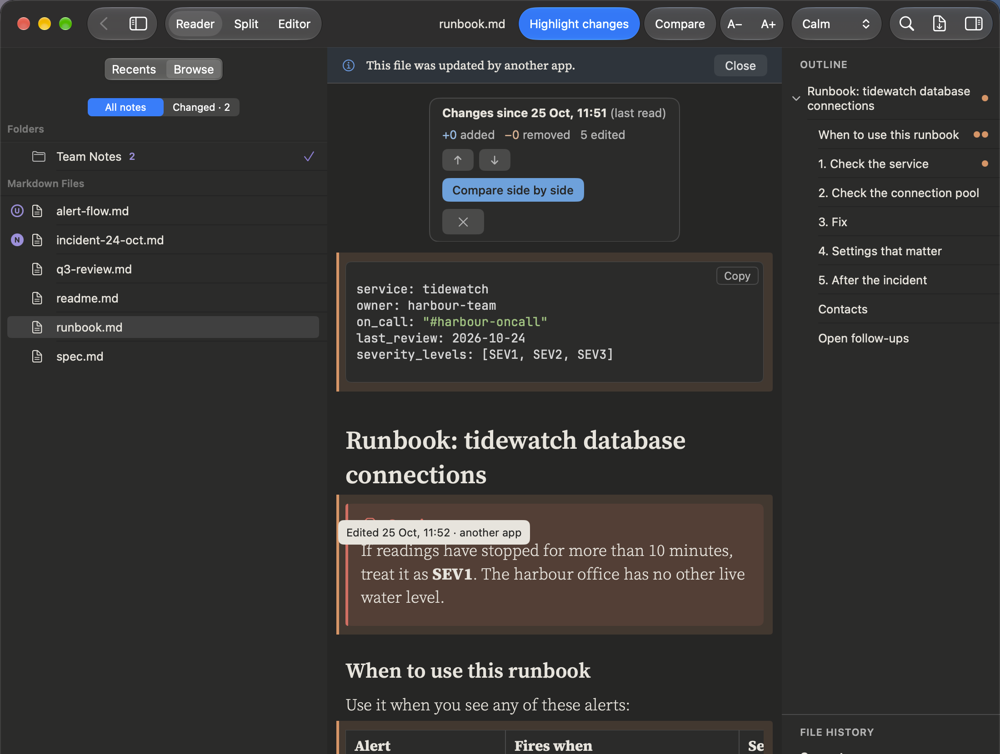

---

## File history

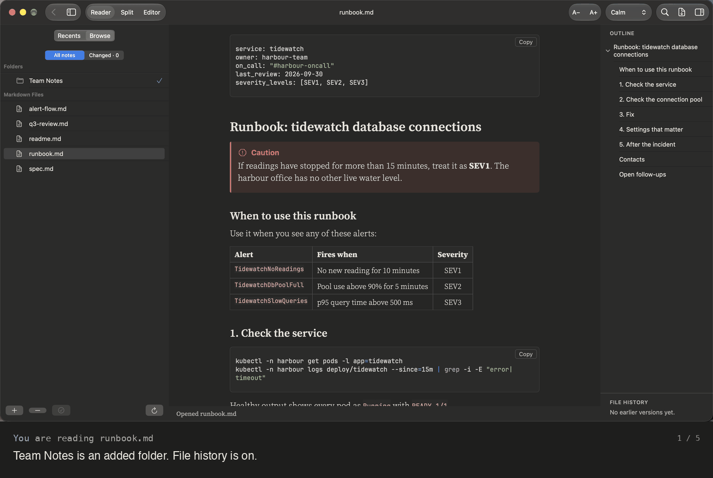

New in 0.3. PilcrowMD keeps earlier versions of your notes on your Mac, so you can see what
changed, compare versions and go back to an older one.

- **See what changed.** When a note changed since you last read it, a banner says so. Click
  Highlight changes and every change is marked in the page, as highlights or as bars in the
  margin. In Browse, the Changed filter lists the notes that changed.
- **Compare versions.** The Compare window shows two versions side by side, as the rendered
  page or as the source. Pick any stored version; copy the changes as a patch.
- **Go back.** The History window lists every stored version, who changed it and how much.
  Restore one, and the file as it is now and any unsaved edits are kept in History first.

File history is off until you turn it on: PilcrowMD asks once, at first launch. Once it is on,
it keeps copies of all files in folders added to Browse, so a change an agent makes to a note
you only read is kept too. In Settings under History you can change which files (files you
save, every file you open, or all files in folders added to Browse), how long copies are kept
(10, 20 or 30 days) and how much space they may use (50 to 500 MB). Copies stay on your Mac.

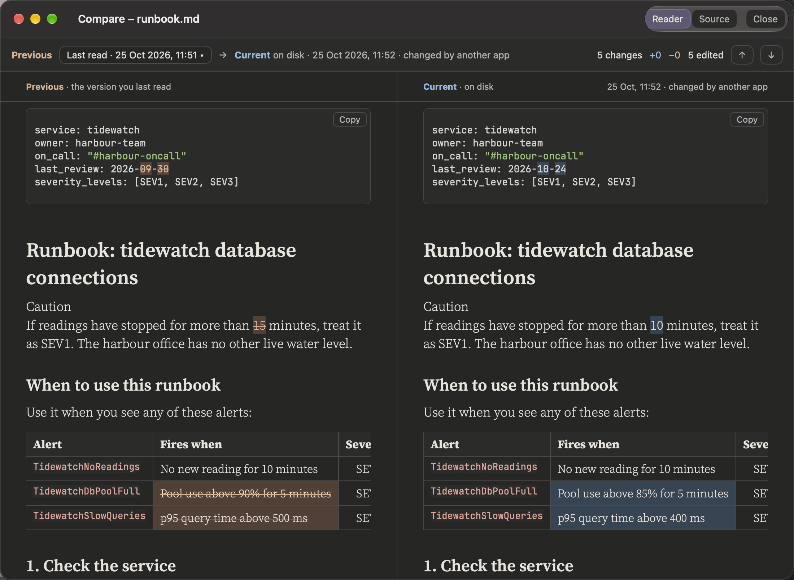

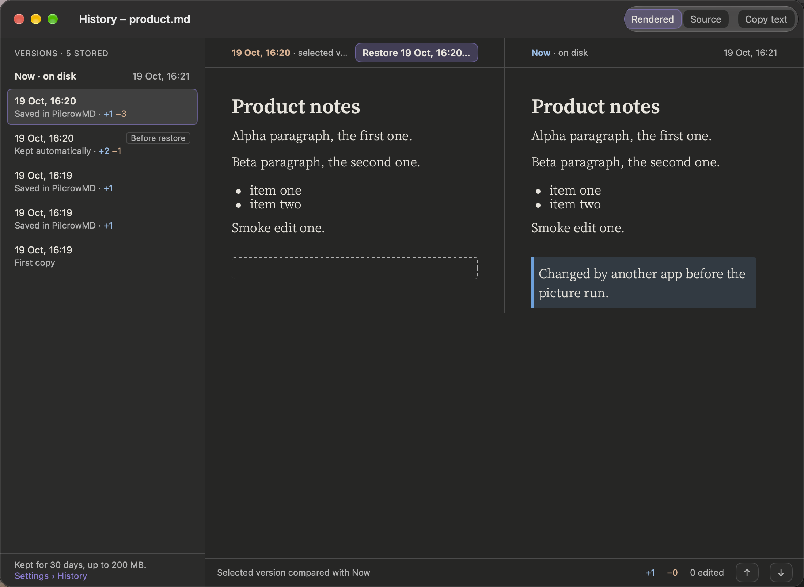

### Also new in 0.3

- **⌘B, ⌘I and ⌘K** make text bold, italic or a link, also from the new Format menu.
- **Quick Look:** press Space on a `.md` file in Finder to see it drawn the PilcrowMD way.
- **Maths:** `\middle|` now draws.
- A new window opens at 1100 × 800, with a wider left pane.


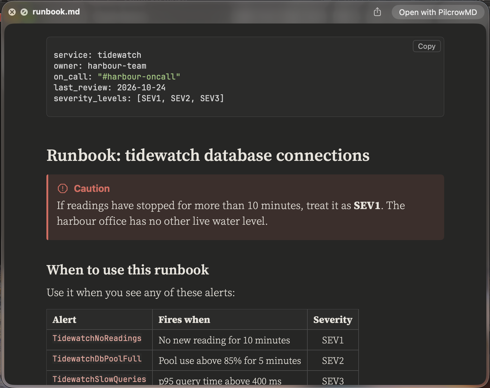

---

## Reading looks

Every note can be read in one of three looks. Calm is the default: roomy and
easy on the eyes. Document is denser, like a printed page. Open has shorter
lines and more space around them.

You switch looks from the menu in the toolbar, or in Settings under Reader.
Settings under Reader also offers Line width (narrower or wider lines) and
Line spacing (closer or more relaxed lines).

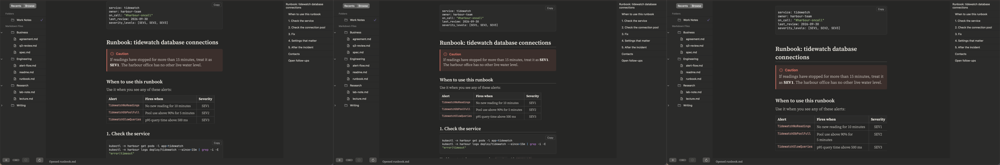

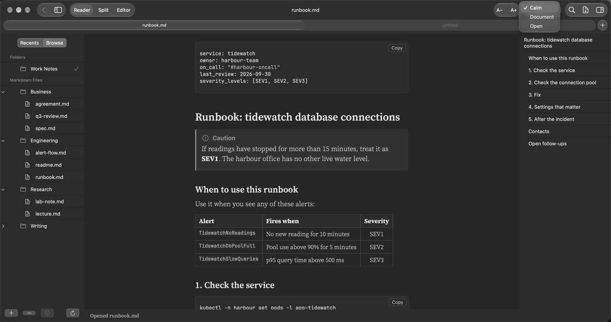

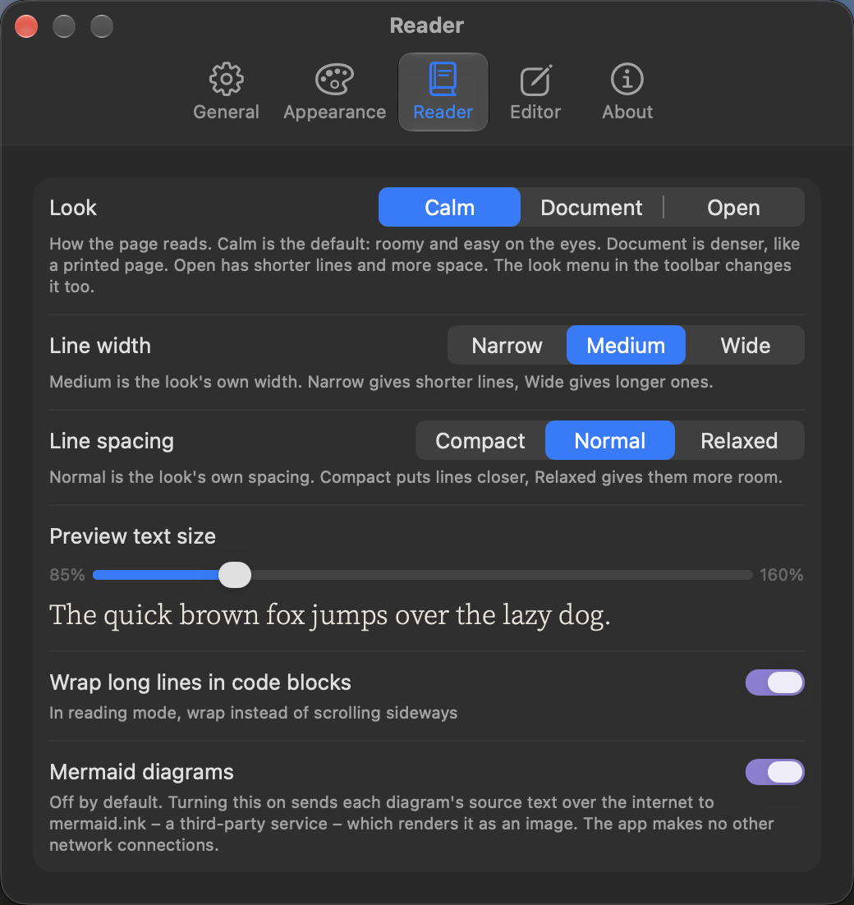

---

## What it shows, for whom

The same app, nine kinds of documents. Every picture is the real app showing one of our
example notes. Click a name to see three pictures and the full list for that kind of note.

| Who | What they write | What PilcrowMD draws for them | |
|:--|:--|:--|:--|
| **[Developers](docs/use-cases/developers.md)** | READMEs, API notes | Code in 28 languages with colours and a Copy button, tables, callouts, task lists, footnotes, collapsible sections | 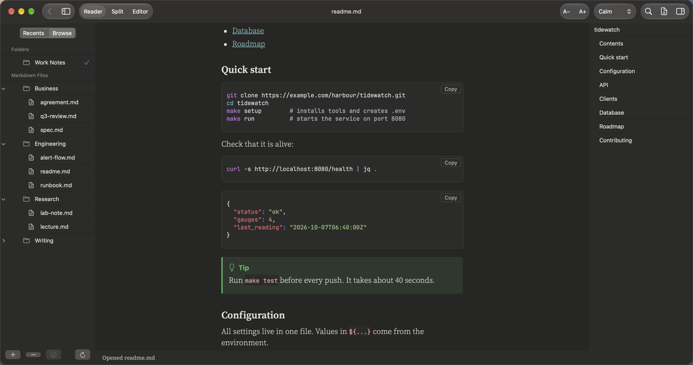 |
| **[Admins and on-call](docs/use-cases/admins.md)** | Runbooks, incident notes | Warning and Caution callouts, shell and SQL with exact spacing, alert tables, checklists | 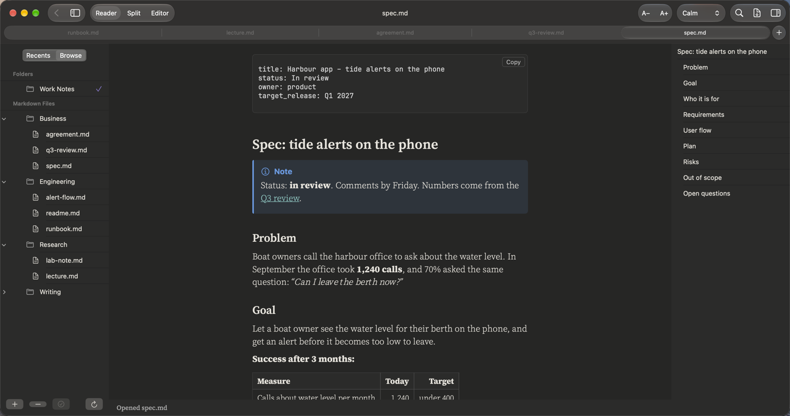 |
| **[Product](docs/use-cases/product.md)** | Specs, plans | Goal and priority tables, task lists, callouts, links between notes |  |
| **[Business](docs/use-cases/business.md)** | Reports, reviews | Tables with numbers aligned right, bold totals, numbered lists, the Light theme | 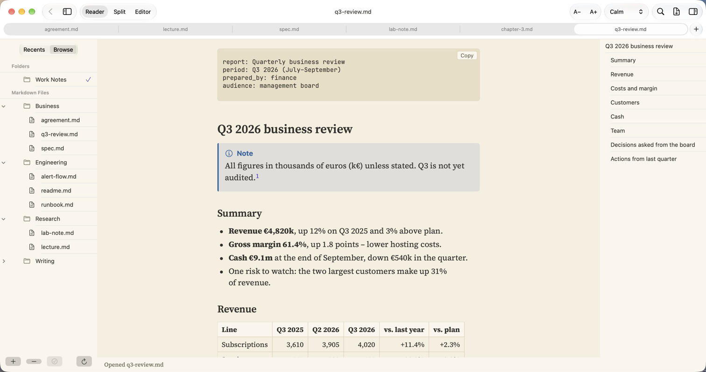 |
| **[Legal](docs/use-cases/legal.md)** | Agreements, clause reviews | Numbered clauses, a contents list with links, definitions tables, review comments in boxes, footnotes | 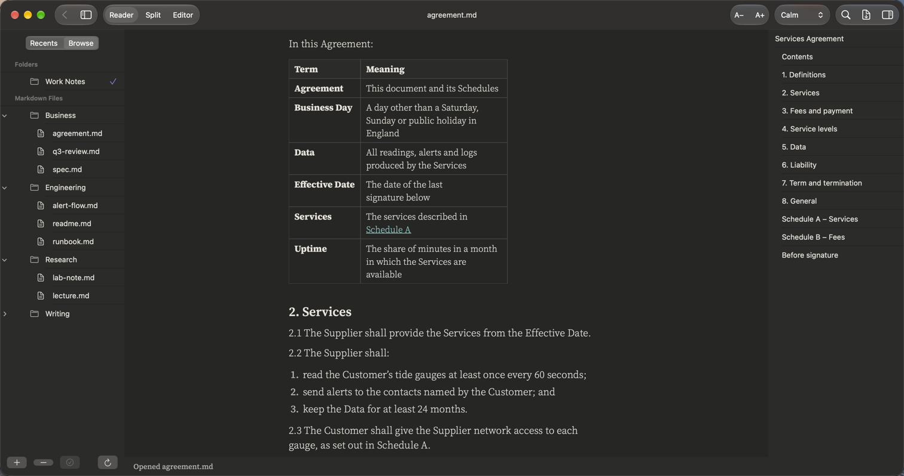 |
| **[Science](docs/use-cases/science.md)** | Lab notes | Formulas with subscripts, results tables, the chart picture inside the page | 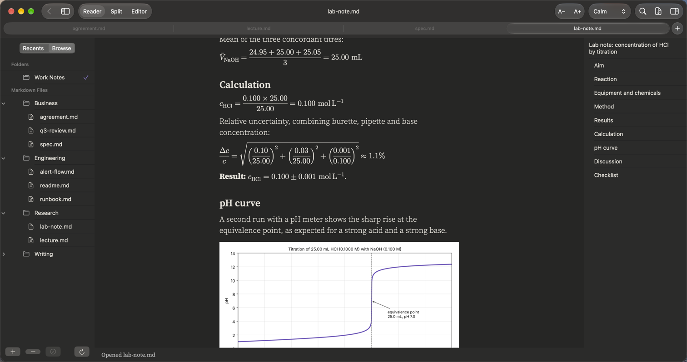 |
| **[Maths](docs/use-cases/maths.md)** | Lectures, problem sets | Inline and display maths, matrices, aligned equations, cases |  |
| **[Writers](docs/use-cases/writers.md)** | Chapters, drafts | A calm serif page, italics and quotes, footnotes you can click, three font sets | 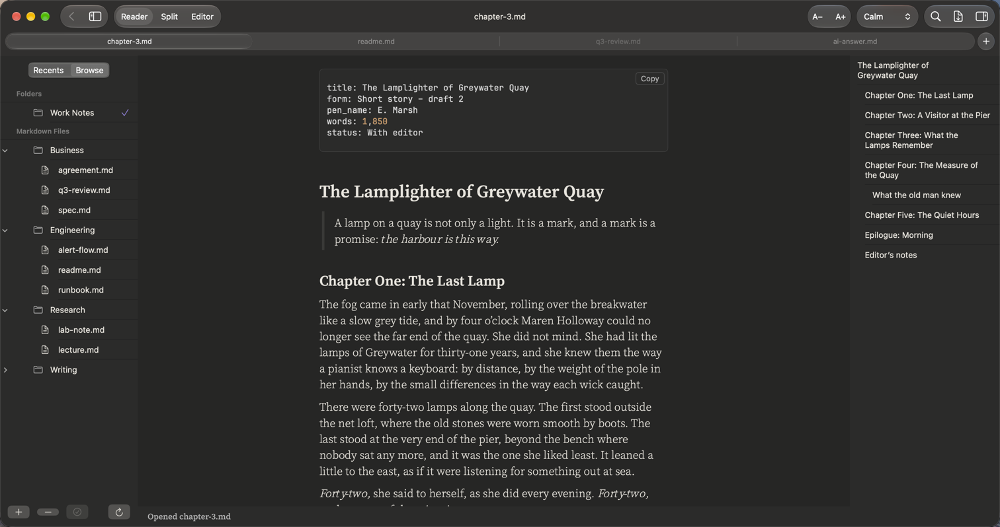 |
| **[AI answers](docs/use-cases/ai-answers.md)** | Saved answers from any AI assistant | Tables, steps, a formula, a checklist and code, as a page instead of raw symbols | 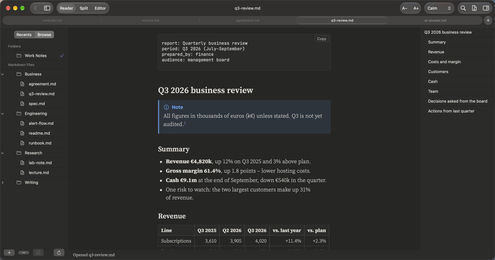 |

Try the same notes yourself: [samples](samples/).

---

## Every Markdown element it draws

| Element | You write | Notes |
|:--|:--|:--|
| Headings, **bold**, *italic*, ~~strike~~, `code` | `# Title`, `**bold**`, `*italic*` | |
| Lists and task lists | `- item`, `1. item`, `- [ ] to do`, `- [x] done` | Ticked and empty boxes |
| Quotes | `> quoted text` | |
| Tables | `\| a \| b \|` with `:--` / `--:` | Column alignment; wide tables scroll sideways |
| Code blocks | ` ```python ` | Colours for 28 languages, Copy button. Fence name in lower case. |
| Maths | `$x^2$`, `$$\frac{a}{b}$$` | Matrices, aligned equations, cases. A formula it cannot draw is shown as its source. |
| Footnotes | `text[^1]` | Click to jump and back |
| Callouts | `> [!NOTE]`, `[!TIP]`, `[!IMPORTANT]`, `[!WARNING]`, `[!CAUTION]` | |
| Collapsible sections | `<details><summary>…</summary>…</details>` | |
| Front matter | `---` block at the top | Shown as a box |
| Pictures | `` | Local pictures; web pictures are never downloaded |
| Links | `[text](other-note.md#heading)`, bare `https://…` | Between notes, to headings, to the web |
| Mermaid diagrams | ` ```mermaid ` | Off by default. When on, diagram text is sent to mermaid.ink to be drawn. |

Shown as plain text, never broken: `[[wiki links]]`, `==highlight==`, `:emoji:` codes, other
HTML. Full list, with what it does not do: [What it does](docs/what-it-does.md).

---

## Folders and agents

Add a folder. When an agent, a script or another app writes a file there, it appears with
**N** (new) or **U** (updated) within a second. An open note updates by itself.

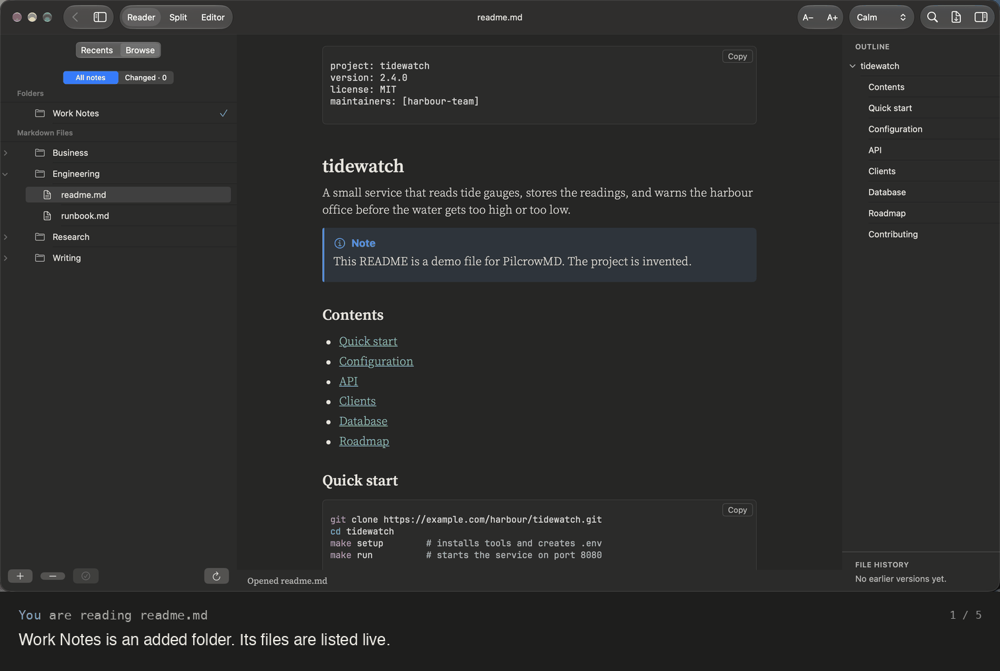

If you are editing a file and an agent saves it too, PilcrowMD shows a banner and asks before
saving: **Save As… / Overwrite / Cancel**. Cancel writes nothing.

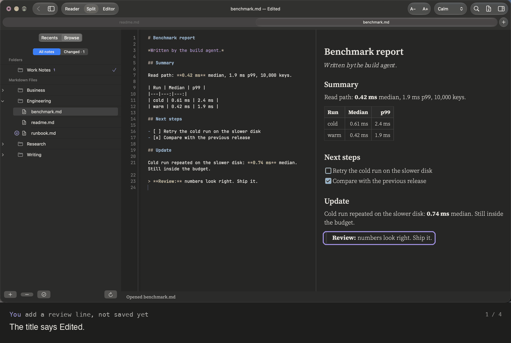

More: [Folders and agents](docs/folders-and-agents.md) · [AI agents use case](docs/use-cases/agents.md)

---

## Your files are safe

- Nothing is written unless you edit. A save is all-or-nothing.
- Another app's changes are never overwritten without asking you.
- No account, no tracking, no network – except Mermaid diagrams, which are off until you turn them on.

Like the Android app, the Mac app draws every page natively, with no web view or browser engine.
Details: [Your files are safe](docs/your-files-are-safe.md).

---

## Also on Android

The Android app is released, open source (GPL-3.0), on Google Play and F-Droid.

[](https://play.google.com/store/apps/details?id=com.pilcrowmd&referrer=utm_source%3Dgithub%26utm_campaign%3Dmac_readme)
[](https://f-droid.org/packages/com.pilcrowmd/)

Source and releases: [github.com/pilcrowmd/pilcrow](https://github.com/pilcrowmd/pilcrow)

---

## Install

macOS 14 (Sonoma) or later. Tested on Apple Silicon; the download also contains an Intel
build, which has not been tested.

Download the DMG, open it, drag PilcrowMD into Applications. The first time you open it,
macOS blocks it because the app is not yet signed by Apple; you allow it once under
**System Settings › Privacy & Security › Open Anyway**. Every step, with a picture:
[INSTALL.md](INSTALL.md).

To remove it, drag it to the Trash. To remove its data too, delete
`~/Library/Preferences/com.pilcrowmd.mac.plist` and the folder
`~/Library/Application Support/PilcrowMac/`.

## Known issues in this beta

- **There is no autosave.** After a crash, PilcrowMD offers to restore edits you had not saved,
  but save often.
- **Mixed line endings become uniform when you save.** Files that use one style throughout
  are saved exactly as they were.
- **A lone carriage return becomes a line break** when you save.
- **Saving breaks hard links.** Aliases and symbolic links are not affected.
- **"Changed" means date or size.** A tool that rewrites a file with exactly the same date and
  size is not noticed.
- **Only UTF-8 files open.** Other encodings are refused with a message saying so.
- **Some characters do not draw inside maths:** curly double quotes and `\blacksquare`.
  The formula then shows as its source text; nothing is lost.
- **Not signed or notarized by Apple** yet – see Install.
- **Intel Macs are untested.**

## Report a problem

[Open an issue on GitHub](https://github.com/pilcrowmd/pilcrow-mac/issues)

## Licence

Free to use, including at work. Install it on any number of Macs and share the link to the
download page. Please do not put the installer on other sites. You may not sell it, change
it, or present it as your own. Provided as is, without warranty – keep backups of your files.

Full text: [LICENSE.md](LICENSE.md).
