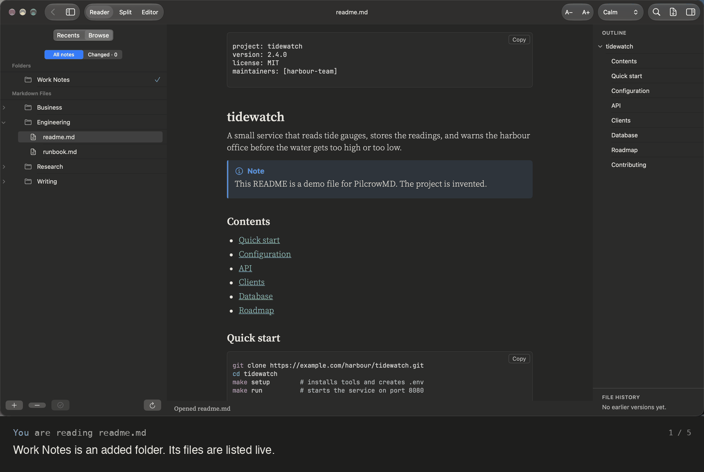
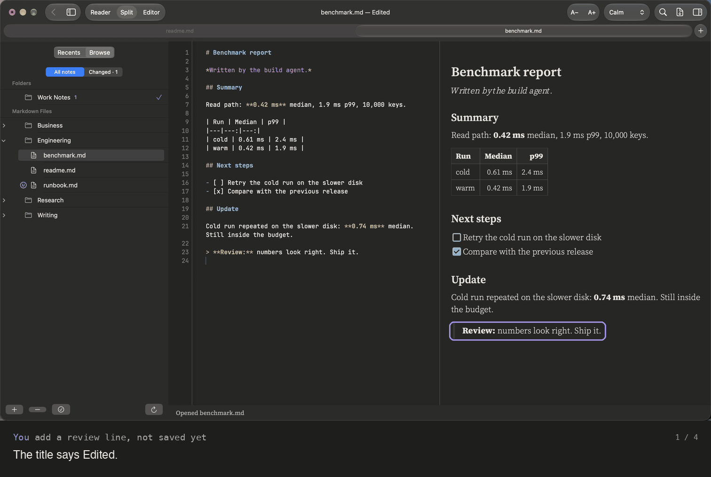

# AI agents

**Reports and notes that agents write while you watch**

Point an agent – Claude Code, Codex, a script, a nightly job – at a folder you added in
PilcrowMD. Every new file shows up within a second (for folders on your Mac's disk) with an **N**. Every file it rewrites gets
a **U**. If you have a report open, the page follows each save.

## What you see

| The agent… | PilcrowMD shows |
|:--|:--|
| creates a file | it in the list with **N** |
| rewrites a file | **U** on that file, and a count on its folder |
| saves the note you are reading | the page reloads, keeping your place |
| saves the note you are editing | a banner, and a choice before anything is overwritten |
| deletes a file | it disappears from the list |

Measured on the beta, for folders on your Mac's disk: a new file shows up 0.3 to 0.8 seconds after it is written.

## When you both edit the same file

You never lose work without choosing to. **Cancel** writes nothing.

## Good to know

- With File history turned on (Settings › History), PilcrowMD keeps earlier versions of notes in My folders for 10 to 30 days, on your Mac, marks what changed since you last read a note (Highlight changes) and compares versions side by side (Compare).

Everything in detail: [Folders and agents](../folders-and-agents.md) · [Your files are safe](../your-files-are-safe.md)

---

[All use cases](../use-cases.md) · [What it does](../what-it-does.md) · [README](../../README.md)
